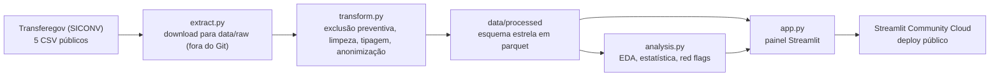
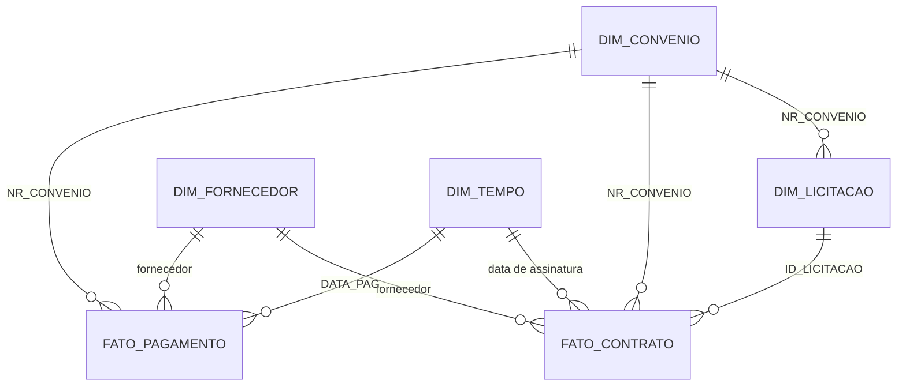

# 📊 GCP_Gestao_Contratos — Sistema de Gestão e Monitoramento de Contratos

[](https://hits.sh/github.com/ClaudiaRamos-Git/GCP_Gestao_Contratos/)

| | |
|---|---|
| 🌐 **App publicado** | https://gcp-gestao-contratos-publicos.streamlit.app (acesso público, sem login) |
| 🎥 **Vídeo (até 3 min)** | https://drive.google.com/file/d/1QyfRB9ywVfY7HOyqay4vpXDPS4bvD_cS/view?usp=sharing |
| 👩‍💻 **Autora** | Claudia Ramos · [LinkedIn](https://www.linkedin.com/in/cl%C3%A1udia-maria-duarte-ramos-17b1151a2/) · [GitHub](https://github.com/ClaudiaRamos-Git) |
| 🎓 **Instituição / Programa** | SENAI/SC · LAB365 — Visualização de Dados e BI — Projeto Final |

---

## 📋 Sumário
1. [Título e resumo](#1-título-e-resumo)
2. [Problema, objetivo e importância](#2-problema-objetivo-e-importância)
3. [Escopo e resultados esperados](#3-escopo-e-resultados-esperados)
4. [Fonte e autorização](#4-fonte-e-autorização)
5. [Pipeline e metodologia](#5-pipeline-e-metodologia)
6. [Bibliotecas e tecnologias](#6-bibliotecas-e-tecnologias)
7. [Resultados encontrados](#7-resultados-encontrados)
8. [Discussão e conclusão](#8-discussão-e-conclusão)
9. [Aplicação profissional](#9-aplicação-profissional)
10. [Aplicação Streamlit](#10-aplicação-streamlit)
11. [Como executar](#11-como-executar)
12. [Estrutura de pastas](#12-estrutura-de-pastas)
13. [Limitações e melhorias futuras](#13-limitações-e-melhorias-futuras)
14. [Créditos e referências](#14-créditos-e-referências)
15. [Links de entrega](#15-links-de-entrega)
16. [Status do projeto](#16-status-do-projeto)

---

## 1. Título e resumo

**GCP_Gestao_Contratos** é um painel interativo (Streamlit) para acompanhar e analisar contratos, licitações, convênios e pagamentos de transferências federais, a partir de dados públicos do Transferegov (ex-SICONV).

O projeto integra quatro tabelas públicas em um **esquema estrela** (modelo dimensional), trata e anonimiza os dados com um fluxo reproduzível em Python (extração, tratamento, análise exploratória) e os apresenta em um painel com filtros e indicadores, com foco em sinalizar **red flags** (alertas de risco) para a prestação de contas.

---

## 2. Problema, objetivo e importância

### Contexto do problema
Atuo há mais de 15 anos em prestação de contas de verbas público-privadas nas esferas federal, estadual e municipal. Dados frágeis na origem (duplicidades, campos em branco, divergências numéricas e sistemas que não conversam entre si) transformam o analista em um "auditor forense manual", perdendo semanas conferindo linha a linha notas fiscais, borderôs e extratos. Um único dado divergente pode gerar questionamentos severos, culminando em **glosa** (devolução do recurso corrigido ao erário) e deixando a instituição inidônea para novos convênios.

### Pergunta de análise
> **É possível automatizar a validação e o cruzamento de dados para mitigar o risco de glosas e garantir a conformidade em convênios público-privados?**

**Como a pergunta é respondida:** o projeto cruza contratos, licitações, convênios e pagamentos do SICONV e aplica regras automáticas de validação que geram **red flags** (alertas de risco) para conferência. O painel **apoia** a mitigação de riscos e a conformidade ao antecipar casos que merecem atenção, mas não as garante: nenhuma das colunas utilizadas registra glosa, então os alertas indicam padrões a conferir, sem afirmar que houve irregularidade.

### Motivação e posicionamento do projeto

O Transferegov já oferece aos seus usuários recursos próprios de acompanhamento e gestão de convênios e contratos, e esse não é o objeto deste projeto. A base do SICONV foi escolhida por um motivo metodológico: é pública, volumosa (milhões de registros), tem estrutura relacional real e apresenta os problemas típicos de dados corporativos, como formatos mistos, campos ausentes, duplicidades e chaves que exigem validação. Ela funciona, assim, como um **substituto realista da base de contratos de uma organização**, sem depender de dados internos ou confidenciais de nenhuma empresa.

O objetivo é demonstrar uma solução replicável: partir de dados brutos, tratá-los e modelá-los com Python e conectá-los a uma camada de visualização e monitoramento (painel interativo em Streamlit) para acompanhar em um só lugar os contratos em execução, seus prazos, valores e pontos de atenção. A mesma arquitetura (extração, tratamento, modelo dimensional e visualização) pode ser aplicada a qualquer organização que gerencie contratos e convênios a partir do seu próprio banco de dados, e o modelo dimensional também pode alimentar outras ferramentas de BI. O que muda é a fonte, não o método.

Dessa forma, o projeto não busca avaliar, substituir ou criticar o Transferegov. Seu propósito é evidenciar que o fluxo de tratamento, integração e monitoramento é viável e reproduzível.

### Para quem é útil
* **Equipes Financeiras e de Compliance:** monitoramento de prazos de vigência, prestação de contas e valores.
* **Auditores, analistas e gestores de convênios:** priorizar conferências e agilizar análises de conformidade.
* **Tomadores de decisão (Diretoria):** painéis executivos com métricas claras sobre o volume de recursos sob gestão.

---

## 3. Escopo e resultados esperados

### Dentro do escopo
* Integração de quatro tabelas públicas do Transferegov: contratos, licitações, convênios e pagamentos.
* Modelagem em esquema estrela, com tratamento e anonimização dos dados.
* Análise exploratória e estatísticas descritivas (distribuições, contagens, tendências no tempo, comparações).
* Red flags (alertas de risco) para a prestação de contas, gerados por regras de validação (seção 5.7).
* Painel interativo em Streamlit com filtros, indicadores e gráficos.

### Fora do escopo
* Identificação de pessoas físicas: nomes e CPFs de fornecedores e favorecidos pessoa física **não** são publicados (seção 5.5).
* Confirmação de irregularidades, glosas efetivas ou causalidade.
* Demais tabelas do Transferegov que não foram selecionadas.

### Resultados esperados e critério de conclusão
* **Redução do tempo operacional:** substituir conferências manuais e planilhas descentralizadas por um painel web.
* **Mitigação de riscos:** evidenciar divergências e prazos críticos para antecipar problemas.
* **Critério de conclusão:** pipeline reproduzível documentado, esquema estrela publicado em parquet, aplicação no Streamlit Community Cloud, código versionado no GitHub e README completo.

---

## 4. Fonte e autorização

| Item | Informação |
|---|---|
| **Fonte** | Transferegov.br — módulo Discricionárias e Legais (ex-SICONV) |
| **Responsável pela publicação** | Governo Federal — Transferegov.br |
| **Link de download** | https://repositorio.dados.gov.br/seges/detru/ |
| **Data de acesso** | 13/10/2026 |
| **Atualização dos arquivos na fonte** | 17/07/2026 (data de publicação de todos os arquivos no repositório) |
| **Período dos dados** | Convênios: assinaturas de 15/09/2008 a 17/07/2026 (convênios assinados, após a exclusão preventiva). Contratos: assinaturas de 02/01/2008 a 17/07/2026 (datas plausíveis; 398 contratos têm data fora dessa janela, seção 5.6). Pagamentos: de 01/2008 a 07/2026 (34 pagamentos têm data fora da janela). **2026 é ano parcial** (arquivos publicados em 17/07/2026). |
| **Licença / termos de uso** | Dados publicados pelo Governo Federal em repositório do domínio dados.gov.br (Portal Brasileiro de Dados Abertos), no âmbito da Política de Dados Abertos do Poder Executivo Federal (Decreto nº 8.777, de 11 de maio de 2016). A página de origem não informa licença específica; o uso neste projeto é restrito à análise agregada, com anonimização de pessoas físicas (seção 5.5). |
| **Método de captura** | Download manual de arquivos CSV públicos oficiais (não há API de convênios disponível para estes conjuntos) |
| **Dados privados?** | Não. Base pública. Não há credenciais, tokens ou documentos confidenciais no repositório. |

### 4.1. Tabelas de origem

| Arquivo | Conteúdo | Chave principal | Chaves de ligação |
|---|---|---|---|
| `siconv_contrato.csv` | Contratos firmados com recursos de convênios (726.602 linhas, 12 colunas) | `ID_CONTRATO` | `ID_LICITACAO`, `ID_FORNECEDOR_CONTRATO` |
| `siconv_licitacao.csv` | Licitações e processos de compra (18 colunas) | `ID_LICITACAO` | `NR_CONVENIO` |
| `siconv_convenio.csv` | Convênios: situação, vigência, prestação de contas e valores (41 colunas) | `NR_CONVENIO` | `ID_PROPOSTA` |
| `siconv_pagamento.csv` | Pagamentos realizados (11 colunas) | `NR_MOV_FIN` | `NR_CONVENIO`, `IDENTIF_FORNECEDOR` |

**Tabela auxiliar:** `siconv_proposta.csv` (identificação do proponente, ligada ao convênio por `ID_PROPOSTA`) é usada **somente no filtro de exclusão preventiva** (seção 5.5). Ela não integra o esquema estrela e não é publicada.

Número de linhas na origem (antes da exclusão preventiva da seção 5.5): licitação 952.712; convênio 285.743; pagamento 7.359.136.

Número de linhas no esquema estrela (após o tratamento): contratos 724.823; convênios 285.611 (235.498 formalizados e 50.113 não formalizados); licitações 941.844; pagamentos 7.318.534.

### 4.2. Dicionário de dados (colunas utilizadas)

> As descrições abaixo se baseiam no nome das colunas e nas primeiras linhas de cada arquivo. Conferir com o dicionário oficial do Transferegov antes da versão final.

Formato dos arquivos: CSV com separador `;`, codificação UTF-8 (o contrato tem BOM), campos vazios frequentes.

**Contrato** (`siconv_contrato.csv`)

| Coluna | Significado | Observações da inspeção inicial |
| :--- | :--- | :--- |
| `ID_LICITACAO` | Licitação associada ao contrato | Sem ausentes |
| `ID_CONTRATO` | Identificador do contrato | 2.866 linhas com ID repetido (1.245 IDs distintos; 1.621 linhas excedentes; nenhuma cópia exata) |
| `NR_CONTRATO` | Número do contrato | Zeros à esquerda: manter como texto |
| `DATA_PUBLICACAO_CONTRATO` | Data de publicação (`AAAA-MM-DD`) | 233.390 ausentes (32%); formato diferente das demais datas |
| `DATA_ASSINATURA_CONTRATO` | Data de assinatura (`DD/MM/AAAA`) | Contém datas impossíveis (anos 0001 e 3010) |
| `DATA_INICIO_VIGENCIA_CONTRATO`, `DATA_FIM_VIGENCIA_CONTRATO` | Vigência do contrato (`DD/MM/AAAA`) | A validar |
| `OBJETO_CONTRATO` | Descrição do objeto | Texto livre longo |
| `TIPO_AQUISICAO_CONTRATO` | Serviço, Material, Material e Serviço, Obras, Serviço de Engenharia | 32.697 ausentes |
| `VALOR_GLOBAL_CONTRATO` | Valor global (R$) | 282 zeros; máximo de R$ 2,2 bilhões (possível outlier) |
| `ID_FORNECEDOR_CONTRATO` | CNPJ (14 dígitos) ou CPF mascarado | 25,5% mascarado (pessoa física); 1.267 linhas em formato não padrão |
| `NOME_FORNECEDOR_CONTRATO` | Nome do fornecedor | Nome completo para pessoa física (**anonimizado**) |

**Licitação** (`siconv_licitacao.csv`): `ID_LICITACAO`, `NR_CONVENIO`, `MODALIDADE_LICITACAO`, `TP_PROCESSO_COMPRA` (ex.: Inexigibilidade, Cotação Prévia de Preços), `TIPO_LICITACAO`, `DATA_PUBLICACAO_LICITACAO`, `DATA_HOMOLOGACAO_LICITACAO`, `STATUS_LICITACAO`, `VALOR_LICITACAO`. Nas primeiras linhas, vários campos aparecem vazios (modalidade, datas).

**Convênio** (`siconv_convenio.csv`): `NR_CONVENIO`, `ID_PROPOSTA`, `SIT_CONVENIO` (ex.: "Em execução", "Prestação de Contas Concluída"), `SUBSITUACAO_CONV`, `INSTRUMENTO_ATIVO`, `DIA_ASSIN_CONV`, `DIA_PUBL_CONV`, `DIA_INIC_VIGENC_CONV`, `DIA_FIM_VIGENC_CONV`, `DIA_FIM_VIGENC_ORIGINAL_CONV`, `DIAS_PREST_CONTAS`, `DIA_LIMITE_PREST_CONTAS`, `QTD_TA` (termos aditivos), `QTD_PRORROGA`, `VL_GLOBAL_CONV`, `VL_REPASSE_CONV`, `VL_CONTRAPARTIDA_CONV`, `VL_EMPENHADO_CONV`, `VL_DESEMBOLSADO_CONV`, `VALOR_GLOBAL_ORIGINAL_CONV`. As demais colunas (por exemplo, `DIA`, `MES`, `ANO`, `NR_PROCESSO`, `UG_EMITENTE`, saldos e rendimentos) não serão usadas na primeira versão. 

*Observações da inspeção do convênio (arquivo de origem, 285.743 linhas):*

* `NR_CONVENIO` é único (um convênio por linha).
* Todas as colunas de data usam `DD/MM/AAAA`. Convertidas com `%d/%m/%Y`, nenhuma data foi perdida na conversão.
* Os seis campos de valor aparecem como número inteiro ou com vírgula decimal; nenhum usa ponto decimal. O tratamento troca a vírgula por ponto e converte para número, sem perdas. Valores negativos foram conferidos nos seis campos: não há em `VL_GLOBAL_CONV`, `VL_REPASSE_CONV`, `VL_DESEMBOLSADO_CONV` nem em `VALOR_GLOBAL_ORIGINAL_CONV`; há 2 em `VL_CONTRAPARTIDA_CONV` e 32 em `VL_EMPENHADO_CONV` (de 285.611 convênios). Foram mantidos como vieram da fonte.
* **50.118 convênios (17,5%) não têm data de assinatura.** Entre os 32.076 que têm situação preenchida: 23.292 "Proposta/Plano de Trabalho Aprovado", 6.658 "Cancelado", 1.299 "Proposta/Plano de Trabalho Complementado Enviado para Análise", 824 "Proposta/Plano de Trabalho Complementado em Análise" e 3 "Convênio Anulado". Os 18.042 restantes (por diferença) não têm situação. Nenhum deles tem contrato ou pagamento ligado (63 licitações de 952.712 se ligam a eles).
* **4 convênios têm início de vigência anterior a 2008** (um deles em 1900), todos sem data de assinatura e sem situação.
* **71 convênios têm fim de vigência depois de 2030**, o que pode ser um prazo longo legítimo; mantidos e apenas registrados aqui.

**Pagamento** (`siconv_pagamento.csv`): `NR_MOV_FIN`, `NR_CONVENIO`, `IDENTIF_FORNECEDOR`, `NOME_FORNECEDOR` (ambos **anonimizados** para pessoa física), `TP_MOV_FINANCEIRA`, `DATA_PAG` (`DD/MM/AAAA`), `DESC_DL` (ex.: "FOLHA DE PAGAMENTO"), `VL_PAGO` (vírgula decimal), `DATA_EMISSAO_DL` (`AAAA-MM-DD`). `NR_DL` e `ID_DL` não serão usados.

---

## 5. Pipeline e metodologia

### 5.1. Visão geral

| Etapa | Descrição | Situação |
|---|---|---|
| 1. Extração | Download dos 4 CSV públicos (mais `siconv_proposta.csv`, só para o filtro) e salvamento em `data/raw/` (fora do Git) | Manual hoje; `src/extract.py` previsto |
| 2. Transformação (ETL) | Exclusão preventiva de convênios, limpeza, tipagem, anonimização e construção das tabelas do esquema estrela em parquet | ✅ `src/transform.py` concluído (4 tabelas em parquet, mais a agregação mensal de pagamentos) |
| 3. Análise (EDA e estatística) | Distribuições, contagens, tendências, comparações e indicadores de risco | ✅ `src/analysis.py` concluído (gera os resultados da seção 7, os CSV de `outputs/` e os red flags por convênio) |
| 4. Visualização (BI) | Painel Streamlit com filtros e indicadores | ✅ `app.py` (painel Streamlit, seção 10) |

**Arquitetura da solução (fluxo de dados):**



### 5.2. Por que um esquema estrela

* **Contratos e pagamentos são eventos diferentes**, com granularidades diferentes (um contrato e um pagamento não são a mesma linha). Cruzá-los direto em uma tabela única multiplicaria linhas e distorceria os valores; no esquema estrela, cada um tem sua tabela fato e o cruzamento ocorre pelas dimensões compartilhadas (convênio, fornecedor e tempo).
* **Separação entre medidas e atributos:** valores e datas ficam nas tabelas fato; textos descritivos e classificações ficam nas dimensões, sem repetição.
* **Desempenho e tamanho:** a base de contratos tem 214 MB em CSV. Com tabelas menores em parquet, o painel lê só o que precisa.
* **Rastreabilidade:** a anonimização é aplicada em um único ponto (`dim_fornecedor`), o que facilita a auditoria do tratamento. Essa tabela é gerada localmente e não é versionada.

### 5.3. Modelo dimensional

| Tabela | Tipo | Grão (cada linha representa) | Origem | No Git? |
|---|---|---|---|---|
| `fato_contrato` | Fato | Um contrato | `siconv_contrato` (`NR_CONVENIO` obtido via licitação) | **Não** (traz nome e CNPJ de fornecedores PJ em cada contrato; gerada localmente) |
| `fato_pagamento` | Fato | Um movimento financeiro de pagamento | `siconv_pagamento` | **Não** (limite de tamanho do GitHub) |
| `dim_convenio` | Dimensão | Um convênio | `siconv_convenio` | Sim |
| `dim_licitacao` | Dimensão | Uma licitação | `siconv_licitacao` | Sim |
| `dim_fornecedor` | Dimensão | Um fornecedor pessoa jurídica (e um registro genérico "ANONIMIZADO" para pessoas físicas) | contrato e pagamento | **Não** (identifica fornecedores PJ; não é usada na análise nem no painel) |
| `dim_tempo` | Dimensão | Um dia do calendário (2000 a 2030) | gerada a partir das datas | Sim |
| `agg_pagamento_convenio_mes` | Agregação | Convênio, mês e tipo de fornecedor | `fato_pagamento` | Sim (usada pela análise) |
| `agg_pagamento_fornecedor_pj` | Agregação | Um favorecido pessoa jurídica | `fato_pagamento` | **Não** (identifica fornecedores PJ; não é usada na análise nem no painel) |
| `agg_contrato_objeto` | Agregação | Objeto de contrato agrupado, por tipo de aquisição, modalidade, tipo de fornecedor e ano | `fato_contrato` | Sim |
| `red_flags_convenio` | Resultado | Um convênio formalizado, com seus alertas e ano de assinatura | `analysis.py` | Sim (usada pelo painel) |
| `contratos_red_flags` | Resultado | Um contrato com ao menos um alerta (RF01 a RF05), sem nomes de fornecedores | `analysis.py` | Sim (usada pelo painel e pelo download) |

Relacionamentos:
* `fato_contrato` → `dim_licitacao` (`ID_LICITACAO`), `dim_convenio` (`NR_CONVENIO`), `dim_fornecedor` e `dim_tempo` (data de assinatura).
* `fato_pagamento` → `dim_convenio` (`NR_CONVENIO`), `dim_fornecedor` e `dim_tempo` (`DATA_PAG`).
* `dim_licitacao` → `dim_convenio` (`NR_CONVENIO`).



Cada tabela é gravada em um arquivo parquet em `data/processed/` (compressão zstd). As agregações existem para manter o repositório e o painel leves.

### 5.4. Chaves e validação das ligações

O cruzamento das tabelas é a primeira etapa a ser testada no pipeline. O formato das chaves é compatível entre os arquivos (numérico em `ID_LICITACAO` e `NR_CONVENIO`), mas a integridade das ligações foi **medida**, e não presumida: o `transform.py` registra quantos contratos encontram licitação, quantas licitações encontram convênio e quantos pagamentos encontram convênio, e reporta as chaves órfãs.

O `transform.py` grava o resultado em `outputs/validacao_chaves.csv` (contrato → licitação, licitação → convênio, pagamento → convênio e contrato → convênio). Resultado da validação (todas as ligações foram 100% integradas, sem chaves órfãs):

| Ligação | Total | Com correspondência | Órfãos | % integrado |
|---|---:|---:|---:|---:|
| Contrato → licitação (`ID_LICITACAO`) | 724.823 | 724.823 | 0 | 100,0% |
| Licitação → convênio (`NR_CONVENIO`) | 941.844 | 941.844 | 0 | 100,0% |
| Pagamento → convênio (`NR_CONVENIO`) | 7.318.534 | 7.318.534 | 0 | 100,0% |
| Contrato → convênio (`NR_CONVENIO`, via licitação) | 724.823 | 724.823 | 0 | 100,0% |

Ressalvas:
* **Fornecedor de pessoa física:** o CPF mascarado traz poucos dígitos visíveis (ex.: `***12345***`), o que não permite ligar contrato e pagamento com segurança. Por isso, para pessoas físicas, o cruzamento ocorre **no nível do convênio** (`NR_CONVENIO`), e não por fornecedor.
* **Fornecedor de pessoa jurídica:** a ligação por CNPJ entre contrato e pagamento não foi usada nesta entrega. O cruzamento entre as tabelas é feito pelo número do convênio (`NR_CONVENIO`). A ligação por CNPJ fica como melhoria futura.

### 5.5. Anonimização e proteção de dados pessoais

O edital do projeto proíbe publicar dados que identifiquem pessoas. As tabelas de contrato e pagamento trazem **nome completo de pessoas físicas** (com CPF mascarado). Decisão adotada:

* Linhas de pessoas físicas são **mantidas**, para não distorcer valores e contagens.
* Nome e CPF mascarado são **substituídos por "Pessoa física"** nas colunas de fornecedor e favorecido (contrato e pagamento).
* É criada a coluna `TIPO_FORNECEDOR` ("Pessoa jurídica" ou "Pessoa física"), derivada do formato do identificador.
* Os arquivos brutos **não são versionados** (ficam só na máquina da autora, em `data/raw/`, listado no `.gitignore`).
* O texto livre do objeto do contrato **não** segue para a tabela publicada: ele é normalizado só para gerar `agg_contrato_objeto`, e objetos com menos de 10 ocorrências viram "OUTROS (objetos pouco frequentes)", para que nenhum texto raro (por exemplo, com nome de pessoa) apareça isolado.
* Como proteção adicional, as linhas de `agg_contrato_objeto` cujo texto de objeto continha número de CNPJ foram removidas da versão publicada (2 de 23.091 linhas, cerca de 0,01%), porque o texto livre identificava a entidade contratante. A agregação final tem 23.089 linhas e a remoção não altera a análise.
* As tabelas que identificam fornecedores pessoa jurídica (`fato_contrato`, `dim_fornecedor` e `agg_pagamento_fornecedor_pj`) **não são versionadas**: o painel e a análise não as usam, e o edital orienta coletar e publicar só o necessário.
* O painel e os arquivos de `outputs/` **não** trazem ranking nominal de fornecedores: a concentração é apresentada só por medidas agregadas (participação dos maiores e HHI). Os arquivos de download não contêm nomes.
* Não serão exibidos rankings nem recortes que permitam identificar indivíduos; análises por fornecedor se restringem a pessoas jurídicas e são apresentadas de forma agregada, sem sugerir irregularidade.

**Conformidade legal e ética.** Os dados são públicos e publicados pelo Governo Federal (seção 4). Nome e CPF de pessoas físicas são dados pessoais nos termos da LGPD (Lei nº 13.709/2018) e, por isso, não são exibidos nem versionados após o tratamento. Os campos utilizados não incluem dados pessoais sensíveis no sentido da LGPD (como saúde, origem racial ou convicção religiosa). Pessoas físicas são anonimizadas. Dados de pessoas jurídicas (CNPJ e razão social) são divulgados na fonte oficial, mas não são versionados nem exibidos neste projeto, e as tabelas publicadas não trazem nome nem CNPJ de fornecedores. Para reduzir o risco de reidentificação, o texto livre do objeto do contrato só aparece agrupado: objetos com menos de 10 ocorrências no total viram "OUTROS (objetos pouco frequentes)" (seção 5.5).

**Exclusão preventiva por independência profissional.** Por precaução, foram retirados da base os convênios ligados a um conjunto restrito de entidades com as quais a autora teve relação profissional anterior (132 de 285.743 convênios, cerca de 0,05%). A lista não é publicada e fica fora do repositório. A exclusão cobre os convênios em que essas entidades aparecem como proponente, fornecedor ou favorecido, e vale para todas as tabelas. Não envolve nenhum juízo sobre as entidades, e a análise não usa documentos ou dados obtidos nessa atuação: toda a base é pública. O filtro está no código (`src/utils.py`, chamado por `src/transform.py`), com verificação automática.

### 5.6. Decisões de tratamento

| Decisão | Justificativa e resultado | Situação |
|---|---|---|
| Ler os CSV com `sep=";"` e `encoding="utf-8-sig"` | Arquivos usam ponto e vírgula; o contrato tem BOM | ✅ Definido |
| Anonimizar pessoas físicas e criar `TIPO_FORNECEDOR` | Edital proíbe identificadores de pessoas (seção 5.5) | ✅ Definido |
| Excluir convênios ligados a entidades com relação profissional anterior da autora | Independência da análise e confidencialidade profissional (seção 5.5). 132 convênios removidos; a cada execução, o código confere que nenhum convênio da lista restou. | ✅ Implementado |
| Não versionar o CSV bruto | Contrato tem 214 MB (limite de 100 MB por arquivo no GitHub) e há nomes de pessoas físicas | ✅ Definido |
| Modelar em esquema estrela, um parquet por tabela | Seção 5.2; modelo efetivamente implementado na seção 5.3 | ✅ Implementado |
| Padronizar separador decimal e tipos numéricos | Valores com vírgula decimal convertidos para número, sem perdas | ✅ Implementado |
| Padronizar formatos de data | `DD/MM/AAAA` e `AAAA-MM-DD` convertidos para data | ✅ Implementado |
| Datas impossíveis no tratamento (contrato) | Em `assinatura`, `início` e `fim de vigência`, datas com ano 1, ano 3010 ou depois de 2030 viram vazio já no `transform.py` | ✅ Implementado |
| Janela de datas plausíveis (contratos e pagamentos) | A base começa em 2008 e foi publicada em 17/07/2026. As análises por ano e por período usam apenas datas de 01/01/2008 a 17/07/2026. **398 contratos** (243 com ano fora de 2008–2026, como o ano 0002 ou 2029, e 155 em 2026 após 17/07/2026) e **34 pagamentos** (anos 1985, 2001 a 2004, 2006, 2007 e 2031; R$ 400.788,24) ficam fora da janela. Os 243 contratos com ano fora do intervalo não entram na tabela por ano; os totais gerais não foram alterados | ✅ Implementado |
| Marcar convênios sem data de assinatura com `FORMALIZADO`, em vez de excluí-los | 50.113 não formalizados e 235.498 formalizados. Nenhum não formalizado tem contrato ou pagamento ligado. Os red flags usam apenas os formalizados | ✅ Implementado |
| Início de vigência anterior a 2008 vira vazio (convênio) | 4 registros incompletos (sem assinatura e sem situação), um deles em 1900 | ✅ Implementado |
| Fim de vigência depois de 2030 (convênio) | 71 registros, que podem ser prazos longos legítimos | Mantidos; apenas registrados |
| `ID_CONTRATO` repetido | 2.866 linhas compartilham 1.245 IDs; 1.621 são excedentes e **nenhuma é cópia exata**, ou seja, são registros diferentes com o mesmo ID. As linhas excedentes somam R$ 2.923.697.370,44 (1,43% do valor total de R$ 204.221.609.935,27); mantendo uma linha por ID, o total seria R$ 201.297.912.564,83. **Decisão: manter todas as linhas** e sinalizar o caso (RF02), pois apagar registros distintos perderia informação | ✅ Definido |
| Valores zero e outliers (contrato) | 282 contratos com valor zero (0,04%), mantidos e sinalizados (RF01). Máximo de R$ 2,24 bilhões mantido: o critério do IQR sobre log10 aponta 546 contratos (0,08%) acima de R$ 24,3 milhões, apenas descritos | ✅ Definido |
| Ausentes | Mantidos como vazios; categorias ausentes recebem "Não informado". Percentuais na seção 7.2 | ✅ Definido |
| Licitação: datas impossíveis e valores extremos | O `transform.py` converte datas e valores da licitação, mas **não os altera**: anos impossíveis (0009, 0007, 2044) e valores extremos (máximo de cerca de R$ 1,43 quadrilhão; 16.735 zeros) permanecem como na fonte. Esses campos não entram em nenhum indicador, alerta ou gráfico; a licitação é usada apenas para modalidade, tipo de processo de compra e a ligação com o convênio | ✅ Definido (mantidos, sem uso analítico) |
| Pagamentos individuais não versionados | `fato_pagamento.parquet` (7.318.534 linhas) é grande demais para o GitHub, que não aceita arquivos acima de 100 MB. Ele fica fora do Git e o repositório publica a agregação `agg_pagamento_convenio_mes`, usada pela análise e pelo painel | ✅ Definido |
| Não versionar `fato_contrato`, `dim_fornecedor` e `agg_pagamento_fornecedor_pj` | As três contêm a identificação (nome e CNPJ) de fornecedores pessoa jurídica. O painel não depende delas: usa só tabelas agregadas e sem nomes (`agg_contrato_objeto`, `contratos_red_flags` e `red_flags_convenio`). Segue o princípio de coletar e publicar apenas o necessário (edital, seção 4.4) e evita ranking ou exposição nominal de empresas. Os arquivos continuam sendo gerados localmente pelo `transform.py`, que deve ser executado antes do `analysis.py` | ✅ Definido |

### 5.7. Red flags (alertas de risco)

Um red flag é uma regra automática que marca contratos ou convênios que merecem conferência. **Um alerta não é prova de irregularidade**: indica um padrão a conferir. As regras abaixo foram implementadas em `src/analysis.py` e exibidas no painel.

| Código | Nível | Regra (limiar) | Colunas usadas | Base | Ocorrências | % |
|---|---|---|---|---:|---:|---:|
| RF01 | Contrato | Valor global zerado (= 0) | `VALOR_GLOBAL_CONTRATO` | 724.823 | 282 | 0,04% |
| RF02 | Contrato | ID de contrato repetido (mais de 1 ocorrência) | `ID_CONTRATO` | 724.823 | 2.866 | 0,40% |
| RF03 | Contrato | Fim de vigência anterior ao início | `DATA_INICIO/FIM_VIGENCIA_CONTRATO` | 724.823 | 0 | 0,00% |
| RF04 | Contrato | Assinatura antes do início ou depois do fim da vigência do convênio | `DATA_ASSINATURA_CONTRATO`, `DIA_INIC/FIM_VIGENC_CONV` | 724.823 | 14.319 | 1,98% |
| RF05 | Contrato | Contratação por inexigibilidade ou dispensa (texto contém "Inexigib" ou "Dispens") | `MODALIDADE_LICITACAO`, `TP_PROCESSO_COMPRA` | 724.823 | 178.844 | 24,67% |
| RF06 | Convênio | Soma dos contratos maior que 1,01 vezes o valor global do convênio | `VALOR_GLOBAL_CONTRATO`, `VL_GLOBAL_CONV` | 235.498 | 21.558 | 9,15% |
| RF07 | Convênio | Soma paga maior que 1,01 vezes o valor desembolsado | `VL_PAGO`, `VL_DESEMBOLSADO_CONV` | 235.498 | 63.664 | 27,03% |
| RF08 | Convênio | Prazo de prestação de contas anterior a 17/07/2026 e situação não encerrada | `DIA_LIMITE_PREST_CONTAS`, `SIT_CONVENIO` | 235.498 | 24.594 | 10,44% |
| RF09 | Convênio | Termos aditivos ou prorrogações acima do percentil 99 | `QTD_TA`, `QTD_PRORROGA` | 235.498 | 2.173 | 0,92% |

Detalhes das regras:
* **Tolerância de 1%** (mais R$ 1) em RF06 e RF07, para não alertar por diferenças de arredondamento.
* **RF08:** considera "encerrados" os convênios cuja situação contém "Conclu", "Aprovad", "Cancel" ou "Anulad". Situações como "Convênio Rescindido" e "Prestação de Contas Rejeitada" **não** são tratadas como encerradas e, por isso, geram alerta. Essa regra pode ser refinada (seção 13).
* **RF05** é uma hipótese legal prevista em lei: serve só para priorizar análise.
* **Nível do convênio:** `QTD_ALERTAS` soma seis sinais por convênio formalizado (valor zero, assinatura fora da vigência, contratado acima do global, pago acima do desembolsado, prestação vencida e muitos aditivos). RF02, RF03 e RF05 são apenas de contrato e não entram nessa soma.
* **Concentração de fornecedores PJ (informativo):** os 10 maiores fornecedores somam 6,04% do valor PJ; HHI de 7,4 (seção 7.6).

**Estatística:** medidas descritivas (contagem, média, mediana, quartis), assimetria, outliers pelo critério do IQR sobre o logaritmo do valor (técnica escolhida pela forte assimetria), comparações entre grupos, tendências no tempo, correlação de Spearman e índice de Herfindahl-Hirschman (HHI). Nenhum resultado é interpretado como causalidade.

---

## 6. Bibliotecas e tecnologias

| Etapa | Ferramenta | Função no projeto |
|---|---|---|
| Linguagem | **Python 3.10+** | Lógica e processamento de dados |
| Tratamento e análise | **Pandas** | Leitura dos CSV, limpeza, tipagem, junções e agregações |
| Cálculo numérico e estatístico | **NumPy** e **SciPy** | Transformações numéricas e correlação de Spearman (usada pelo Pandas) |
| Armazenamento | **PyArrow** (parquet) | Gravar e ler as tabelas do esquema estrela em formato colunar compactado |
| Visualização | **Plotly Express** | Gráficos interativos |
| Aplicação BI | **Streamlit** | Interface web, filtros, métricas e publicação |
| Ambiente | **venv** | Isolamento das dependências |
| Versionamento | **Git e GitHub** | Histórico e repositório |

Documentação oficial: [Python](https://docs.python.org/3/), [Pandas](https://pandas.pydata.org/docs/), [PyArrow](https://arrow.apache.org/docs/python/), [Plotly](https://plotly.com/python/), [Streamlit](https://docs.streamlit.io/).

O SciPy é necessário para a correlação de Spearman (`DataFrame.corr(method="spearman")`). O `requirements.txt` lista Streamlit, Pandas, PyArrow, Plotly, NumPy e SciPy.

---

## 7. Resultados encontrados

Todos os números abaixo são gerados por `python src/analysis.py` e gravados em `outputs/` (CSV com separador `;` e decimal `,`). Valores em R$. Cada seção separa o que foi **observado** nos dados do que seria hipótese (seção 8).

### 7.1. Visão geral e período
| Item | Valor |
|---|---|
| Contratos | 724.823 |
| Convênios | 285.611 (235.498 formalizados) |
| Licitações | 941.844 |
| Pagamentos | 7.318.534, somando R$ 132.877.985.200,93 |
| Valor global dos contratos | R$ 204.221.609.935,27 |
| Período dos contratos (datas plausíveis) | 02/01/2008 a 17/07/2026 |
| Período dos pagamentos (janela plausível) | 01/2008 a 07/2026 |

### 7.2. Qualidade dos dados
| Tabela | Coluna | Ausentes | % |
|---|---|---:|---:|
| Contrato | `DATA_PUBLICACAO_CONTRATO` | 232.887 | 32,13% |
| Contrato | `DATA_ASSINATURA_CONTRATO` | 7 | 0,00% |
| Contrato | `DATA_FIM_VIGENCIA_CONTRATO` | 28 | 0,00% |
| Contrato | `TIPO_AQUISICAO_CONTRATO` ("Não informado") | 32.697 | 4,51% |
| Convênio | `DIA_ASSIN_CONV` | 50.113 | 17,55% |
| Convênio | `VL_EMPENHADO_CONV` | 13.451 | 4,71% |
| Convênio | `VL_DESEMBOLSADO_CONV` | 98.437 | 34,47% |
| Convênio | `VALOR_GLOBAL_ORIGINAL_CONV` | 200.820 | 70,31% |
| Convênio | `SIT_CONVENIO` ("Não informado") | 18.047 | 6,32% |
| Licitação | `DATA_PUBLICACAO_LICITACAO` | 656.192 | 69,67% |
| Licitação | `DATA_HOMOLOGACAO_LICITACAO` | 453.869 | 48,19% |
| Licitação | `MODALIDADE_LICITACAO` ("Não informado") | 667.469 | 70,87% |
| Licitação | `VALOR_LICITACAO` | 1.009 | 0,11% |

Duplicidade: 2.866 linhas de contrato compartilham 1.245 `ID_CONTRATO` (decisão na seção 5.6).

### 7.3. Distribuição do valor global dos contratos
* Média de R$ 281.753,77; **mediana de R$ 17.160,00**; desvio-padrão de R$ 5.058.139,43; assimetria de 253,8. A média é muito maior que a mediana: poucos contratos de valor muito alto puxam a média.
* Percentis: p1 R$ 30,00; p5 R$ 330,90; p25 R$ 3.558,00; p50 R$ 17.160,00; p75 R$ 121.950,00; p90 R$ 430.893,16; p95 R$ 845.595,83; p99 R$ 4.078.930,20; máximo R$ 2.244.213.000,00.
* **Os 1% maiores contratos (7.248) concentram 46,84% do valor total; os 10% maiores (72.482), 81,48%.**
* Outliers (IQR sobre log10 dos valores maiores que zero): limite de R$ 24.321.228,47, com 546 contratos acima (0,08%).
* Contratos com valor zero: 282 (0,04%).

**Como ler estas medidas:**
* **Média:** soma de todos os valores dividida pela quantidade de contratos. É sensível a valores muito altos.
* **Mediana:** o valor do meio quando os contratos são ordenados do menor ao maior. Metade dos contratos vale menos que ela e metade vale mais. Por isso representa melhor o contrato típico quando há valores extremos.
* **Desvio-padrão:** quanto os valores costumam se afastar da média. Quanto maior, mais espalhados.
* **Assimetria:** indica para qual lado a distribuição pende. Perto de 0 é equilibrada; um valor positivo alto, como aqui, mostra uma cauda longa de poucos valores muito altos.
* **Percentil:** o valor abaixo do qual fica uma certa parcela dos contratos. Por exemplo, o p90 é o valor que 90% dos contratos não superam. O p50 é a mediana, e os quartis são os percentis 25, 50 e 75.
* **Outliers e IQR:** o intervalo interquartil (IQR) é a distância entre o 1º e o 3º quartil. Valores muito fora dessa faixa são tratados como atípicos (outliers). Aqui o critério é aplicado ao logaritmo do valor, que reduz o peso dos valores gigantes.
* **Correlação:** mede se duas variáveis variam juntas, em uma escala de -1 a 1. Perto de 0 significa pouca relação; correlação não prova que uma causa a outra.

### 7.4. Tendência no tempo
Contratos assinados por ano (datas plausíveis; 2026 é parcial, até 17/07):

| Ano | Contratos | Valor total (R$ bi) | Valor mediano (R$) |
|---|---:|---:|---:|
| 2008 | 1.505 | 0,88 | 15.000,00 |
| 2009 | 20.199 | 2,34 | 5.500,00 |
| 2010 | 56.719 | 6,89 | 4.500,00 |
| 2011 | 46.199 | 7,37 | 9.600,00 |
| 2012 | 36.706 | 9,75 | 11.734,78 |
| 2013 | 37.002 | 12,42 | 16.200,00 |
| 2014 | 42.049 | 12,43 | 17.480,00 |
| 2015 | 37.280 | 10,82 | 25.200,00 |
| 2016 | 30.823 | 5,92 | 21.000,00 |
| 2017 | 31.494 | 6,66 | 21.600,00 |
| 2018 | 35.340 | 8,64 | 40.142,25 |
| 2019 | 34.390 | 8,61 | 49.200,00 |
| 2020 | 28.638 | 9,56 | 74.635,34 |
| 2021 | 30.593 | 10,18 | 30.096,00 |
| 2022 | 42.090 | 13,80 | 21.600,00 |
| 2023 | 38.422 | 12,22 | 20.000,00 |
| 2024 | 53.460 | 16,68 | 15.300,00 |
| 2025 | 76.905 | 27,33 | 13.334,42 |
| 2026 (parcial) | 44.759 | 21,14 | 17.485,02 |

2025 é o ano de maior quantidade (76.905) e de maior valor (R$ 27,33 bi). Não se calcula variação percentual para 2026, por ser ano parcial.

Pagamentos por ano (2008 a 2026): crescem de R$ 15,8 milhões em 2008 (812 pagamentos) para R$ 15,15 bi em 2025 (589.273 pagamentos); 2026 parcial soma R$ 9,31 bi (312.704).

Pagamentos por tipo de fornecedor:

| Tipo | Pagamentos | % | Valor pago | % |
|---|---:|---:|---:|---:|
| Pessoa física | 4.299.292 | 58,75% | R$ 10,07 bi | 7,58% |
| Pessoa jurídica | 3.019.242 | 41,25% | R$ 122,81 bi | 92,42% |

Pagamento individual: mediana de R$ 1.434,08; p90 de R$ 22.500,00; p99 de R$ 325.743,60; máximo de R$ 46.468.796,07.

### 7.5. Comparações entre grupos (contratos)
**Por tipo de aquisição:**

| Tipo | Contratos | % contratos | Valor total (R$ bi) | % valor | Mediana (R$) |
|---|---:|---:|---:|---:|---:|
| Serviço | 325.925 | 44,97% | 39,33 | 19,26% | 8.960,00 |
| Material | 269.660 | 37,20% | 47,00 | 23,01% | 20.539,39 |
| Material e Serviço | 61.451 | 8,48% | 19,60 | 9,60% | 50.300,00 |
| Não informado | 32.697 | 4,51% | 67,99 | 33,29% | 625.503,12 |
| Obras | 30.049 | 4,15% | 25,42 | 12,45% | 317.683,15 |
| Serviço de Engenharia | 5.041 | 0,70% | 4,88 | 2,39% | 302.641,63 |

**Por modalidade de licitação:**

| Modalidade | Contratos | % contratos | Valor total (R$ bi) | % valor | Mediana (R$) |
|---|---:|---:|---:|---:|---:|
| Não informado | 441.166 | 60,87% | 41,79 | 20,46% | 7.423,08 |
| Pregão | 149.135 | 20,58% | 38,60 | 18,90% | 41.200,00 |
| Tomada de Preços | 76.005 | 10,49% | 32,86 | 16,09% | 302.987,73 |
| Concorrência | 28.910 | 3,99% | 87,06 | 42,63% | 939.133,28 |
| Concurso | 19.393 | 2,68% | 1,06 | 0,52% | 10.000,00 |
| Convite | 9.962 | 1,37% | 0,79 | 0,39% | 53.293,82 |
| RDC | 250 | 0,03% | 2,07 | 1,02% | 926.954,64 |
| Diálogo competitivo | 2 | 0,00% | 0,00 | 0,00% | 71.022,94 |

**O que significam as modalidades:** a modalidade é a forma legal pela qual o órgão escolhe quem vai fornecer o bem ou o serviço.
* **Pregão:** disputa por menor preço para bens e serviços de uso comum.
* **Concorrência:** usada em contratações de maior valor ou complexidade, com ampla participação.
* **Tomada de Preços:** destinada a fornecedores previamente cadastrados, em valores intermediários.
* **RDC (Regime Diferenciado de Contratações Públicas):** regime próprio de licitação criado pela Lei nº 12.462/2011, inicialmente para obras da Copa e das Olimpíadas e depois ampliado a outras áreas. É raro nesta base.
* **Dispensa de licitação e inexigibilidade:** contratação direta, sem disputa. A dispensa vale para os casos que a lei permite; a inexigibilidade, quando a competição é inviável (por exemplo, fornecedor exclusivo).
* **Convite:** modalidade para contratações de menor valor, em que o órgão convida um número mínimo de fornecedores.
* **Concurso:** escolha de trabalho técnico, científico ou artístico, normalmente com prêmio ou remuneração ao vencedor.
* **Diálogo competitivo:** usado em contratações complexas ou inovadoras, em que o órgão conversa com os licitantes antes da proposta final.
* **Não informado:** a modalidade não foi registrada. Em sua maior parte significa "não se aplica", porque o processo não é uma licitação (seção 7.5).

**Sobre "Não informado" na modalidade (60,87% dos contratos e 20,46% do valor):** a modalidade só existe para processos do tipo licitação. O cruzamento com o tipo de processo de compra (`outputs/modalidade_x_processo.csv` e aba *Modalidade x processo* do painel) mostra que a ausência vem, quase toda, de processos que **não são licitação**:

| Tipo de processo | Contratos | Sem modalidade | % do tipo sem modalidade | % de todos os sem modalidade |
|---|---:|---:|---:|---:|
| Cotação Prévia de Preços | 162.638 | 162.638 | 100,0% | 36,9% |
| Dispensa de Licitação | 112.942 | 112.942 | 100,0% | 25,6% |
| Inexigibilidade | 65.902 | 65.902 | 100,0% | 14,9% |
| Cotação Eletrônica | 44.214 | 44.214 | 100,0% | 10,0% |
| Pesquisa de Mercado (valor abaixo de R$ 8.000,00) | 29.051 | 29.051 | 100,0% | 6,6% |
| Licitação | 273.717 | 19.654 | 7,2% | 4,5% |
| Não informado | 36.359 | 6.765 | 18,6% | 1,5% |

**Leitura:** em 5 tipos de processo sem licitação, 100% dos contratos não têm modalidade, e eles respondem por 414.747 dos 441.166 contratos sem modalidade (94,0%). Entre os contratos de **licitação**, só 7,2% (19.654) não têm modalidade preenchida. A falta de preenchimento real é, portanto, pequena: 26.419 contratos (licitação e processo não informado), ou 3,6% do total de 724.823. Por isso, comparações por modalidade devem considerar que "Não informado" significa, na maior parte, "não se aplica".

**Por tipo de fornecedor:** pessoa jurídica, 538.641 contratos (74,31%) e R$ 197,14 bi (96,53% do valor); pessoa física, 186.182 contratos (25,69%) e R$ 7,08 bi (3,47%). A mediana é de R$ 31.680,00 para pessoa jurídica e R$ 4.500,00 para pessoa física.

**Tipo de processo de compra:** Licitação 273.717; Cotação Prévia de Preços 162.638; Dispensa de Licitação 112.942; Inexigibilidade 65.902; Cotação Eletrônica 44.214; Não informado 36.359; Pesquisa de Mercado (valor abaixo de R$ 8.000,00) 29.051.

### 7.6. Relações e concentração
**Correlação de Spearman entre variáveis do convênio** (associação, não causalidade):

| | Valor global | Duração da vigência | Qtd. termos aditivos | Qtd. prorrogações |
|---|---:|---:|---:|---:|
| Valor global | 1,000 | 0,301 | 0,102 | 0,045 |
| Duração da vigência | 0,301 | 1,000 | 0,616 | 0,334 |
| Qtd. termos aditivos | 0,102 | 0,616 | 1,000 | 0,069 |
| Qtd. prorrogações | 0,045 | 0,334 | 0,069 | 1,000 |

**Concentração de fornecedores pessoa jurídica:** 153.954 fornecedores, 538.641 contratos e R$ 197,14 bi. Os 5 maiores concentram 3,78% do valor PJ; os 10 maiores, 6,04%; os 100 maiores, 18,22%. HHI de 7,4 (abaixo de 1.500 indica baixa concentração). Um único fornecedor chega a 1.044 contratos, e o maior valor somado por um fornecedor é de R$ 2,26 bi. Os nomes não são divulgados.

### 7.7. Red flags
Resultados por regra na tabela da seção 5.7. Por convênio formalizado (235.498):

| Nº de alertas | Convênios | % |
|---|---:|---:|
| 0 | 140.662 | 59,73% |
| 1 | 75.657 | 32,13% |
| 2 | 16.793 | 7,13% |
| 3 | 2.238 | 0,95% |
| 4 | 146 | 0,06% |
| 5 | 2 | 0,00% |

**94.836 convênios (40,27%) têm ao menos um alerta** e 2.386 (1,01%) têm três ou mais. Entre os convênios com prestação de contas vencida (RF08), as situações mais frequentes são "Prestação de Contas Concluída" (89.080) e "Prestação de Contas Aprovada" (42.803), tratadas como encerradas; as demais compõem o alerta.

---

## 8. Discussão e conclusão

**Resposta à pergunta de análise.** É possível automatizar o cruzamento de contratos, licitações, convênios e pagamentos e gerar alertas que ajudam a priorizar conferências: 40,27% dos convênios formalizados têm ao menos um alerta, e 1,01% têm três ou mais, o que permite começar a análise pelos casos mais sinalizados. O projeto **apoia** a mitigação de riscos de glosa, mas não a garante, porque nenhuma coluna da base registra glosa.

**Observações (apoiadas nos números da seção 7):**
* O valor é muito concentrado em poucos contratos (1% dos contratos = 46,84% do valor), mas pouco concentrado em fornecedores PJ (HHI de 7,4).
* Contratos de "tipo de aquisição não informado" são 4,51% do total e 33,29% do valor, com mediana de R$ 625.503,12. A qualidade desse campo afeta diretamente qualquer leitura por tipo.
* Concorrência é 3,99% dos contratos e 42,63% do valor; Pregão e Tomada de Preços dividem boa parte do restante.
* Pessoas físicas são 58,75% dos pagamentos, mas 7,58% do valor pago.
* Convênios com vigência mais longa tendem a ter mais termos aditivos (Spearman de 0,616).
* 94,0% dos contratos sem modalidade vêm de processos que não são licitação (cotação, dispensa, inexigibilidade, pesquisa de mercado), e entre os contratos de licitação só 7,2% estão sem modalidade (seção 7.5): a modalidade "Não informado" é, em sua maior parte, "não se aplica".
* 2025 foi o ano de maior quantidade e valor de contratos; 2026 é parcial.

**Hipóteses (não testadas):**
* A alta proporção de pagamentos acima do valor desembolsado (RF07: 27,03%) pode refletir diferenças de registro, por exemplo pagamentos que incluem contrapartida ou rendimentos, e não necessariamente excesso de gasto. É preciso conferir o dicionário oficial antes de tratá-la como sinal forte.
* A forte alta de contratos entre 2008 e 2010 pode refletir a implantação gradual do sistema, e não aumento real da atividade.
* RF05 (24,67%) mostra que dispensa e inexigibilidade são frequentes, mas são hipóteses legais; o alerta só indica onde olhar.

**Limites e o que não pode ser inferido.** Os alertas não demonstram irregularidade, glosa ou causalidade. Há campos com muitos ausentes (por exemplo, 70,87% das licitações sem modalidade e 34,47% dos convênios sem valor desembolsado), o que limita as regras que os usam. A correlação indica associação, não causa.

**Recomendações:** (1) priorizar a conferência dos convênios com três ou mais alertas; (2) validar RF07 e RF08 com o dicionário oficial antes de uso operacional; (3) em uma organização, aplicar as mesmas regras à base interna, onde os campos de valor e situação são mais completos.

---

## 9. Aplicação profissional

**Valor potencial.** O mesmo fluxo (extração, tratamento, modelo dimensional, regras de alerta e painel) pode ser aplicado à base de contratos e convênios de uma organização, substituindo conferências manuais por uma triagem automática: o analista começa pelos casos com mais alertas, em vez de revisar linha a linha.

**Requisitos para uso corporativo:**
* **Atualização das bases:** reprocessar o pipeline a cada nova carga (`transform.py`, depois `analysis.py`). Hoje o download é manual; automatizar a extração é uma melhoria prevista.
* **Qualidade dos dados:** as regras dependem de campos completos (valor desembolsado, situação, vigência). Em base interna, esses campos tendem a ser mais confiáveis do que na base pública.
* **Segurança e privacidade:** em dados reais da organização, manter o repositório e o painel com acesso restrito, anonimizar ou limitar dados pessoais conforme a LGPD e não versionar dados brutos (mesma lógica do `.gitignore`, seção 12).
* **Governança:** definir quem valida os limiares (tolerância de 1%, percentil 99) e como os alertas são tratados, registrando o resultado da conferência para calibrar as regras.
* **Manutenção:** testes automatizados do tratamento e documentação das regras, mantidas na seção 5.7.

**Riscos.** Tratar alerta como acusação; confiar em regras sem validar o significado dos campos; e expor dados sensíveis. Por isso o painel traz o aviso de que alerta é ponto a conferir.

---

## 10. Aplicação Streamlit

* **Link do deploy:** https://gcp-gestao-contratos-publicos.streamlit.app 
* **Como acessar:** abra o link acima em qualquer navegador (acesso público, sem login). Se o app estiver em repouso por falta de acessos, aparece um botão para reativá-lo, e ele volta em alguns instantes. Para rodar no seu computador, veja o Passo 6 da instalação.
* **Como foi publicado:** Streamlit Community Cloud, a partir da branch `main` deste repositório, arquivo principal `app.py`, Python 3.11 e dependências do `requirements.txt`.
* **Fonte de dados do painel:** `data/processed/red_flags_convenio.parquet`, `data/processed/contratos_red_flags.parquet`, `data/processed/agg_contrato_objeto.parquet` e os CSV de `outputs/`, gerados por `src/transform.py` e `src/analysis.py`. O painel não lê os dados brutos nem os pagamentos individuais.
* **Identidade visual:** tema escuro, com painel lateral à esquerda, etiquetas coloridas e listas, definido em `app.py` e em `.streamlit/config.toml`.
* **Boas práticas de leitura:** todos os gráficos têm título, eixos com unidade, legenda e fonte; o painel mostra os **filtros ativos** e o **recorte exibido**; 2026 aparece como ano parcial; e há mensagens quando um filtro não retorna dados.

**Navegação (painel lateral esquerdo):**

| Página | O que mostra | Filtros |
|---|---|---|
| Visão geral | Pergunta e fonte do projeto, indicadores (contratos, valor contratado, valor pago e % de convênios com alerta) e gráficos por ano | Período |
| Red flags | Tabela das nove regras, gráfico de % por regra, distribuição de convênios por número de alertas e **download da lista de contratos por alerta (RF01 a RF05)** | Escolha do alerta |
| Convênios | Lista priorizada por alertas, painel de detalhe à direita e **download da lista filtrada** | Período (ano de assinatura), situação, mínimo de alertas e alertas exigidos; busca por número |
| Contratos | Contratos por ano e comparações (% dos contratos x % do valor) por tipo de aquisição, modalidade e pessoa física x jurídica; objetos mais frequentes; modalidade x processo; concentração de fornecedores PJ | Período, tipo de aquisição, modalidade e tipo de fornecedor |
| Metodologia | Fonte, janela de datas, decisão sobre IDs repetidos, privacidade e aviso sobre o significado dos alertas | — |

**Página Convênios (leitura por convênio):**
* **Lista:** até 500 convênios por vez (para manter o painel leve), ordenados por número de alertas e, em seguida, por valor pago. A contagem exibida mostra quantos existem no filtro.
* **Detalhe (painel à direita):** número, situação, alertas ativos (ou "Sem alertas"), valor global, soma dos contratos e soma paga.
* **Alertas por convênio:** valor zero, assinatura fora da vigência, contratado acima do global, pago acima do desembolsado, prestação de contas vencida e muitos aditivos ou prorrogações (regras na seção 5.7).

**Como abrir os CSV baixados:** os arquivos usam ponto e vírgula (`;`) como separador de colunas e vírgula como separador decimal, o padrão do Excel em português. Para abrir corretamente, baixe o arquivo e dê dois cliques nele para abri-lo no Excel (ou no LibreOffice Calc). Evite abri-lo em editores de texto, como o VS Code: a vírgula decimal é lida como separador e os valores aparecem cortados. Se o Excel mostrar tudo em uma coluna só, use **Dados > De Texto/CSV** e escolha o delimitador ponto e vírgula. Nas colunas de alerta, os valores vêm como "Sim" e "Não".

**Como ler:** um alerta é um ponto a conferir, não prova de irregularidade. Os valores vêm de arquivos diferentes (contratos, pagamentos e convênio), e divergências podem refletir diferenças de registro. A página Contratos usa a agregação por objeto: objetos com menos de 10 ocorrências ficam agrupados em "OUTROS", e contratos com data inválida ficam fora do recorte por período.

---

## 11. Como executar

A aplicação usa apenas caminhos relativos e não depende de credenciais ou variáveis de ambiente.

### Pré-requisitos
* Python 3.10+ ([Download](https://www.python.org/downloads/)). No Windows, marque "Add Python to PATH".
* Git ([Download](https://git-scm.com/)), opcional.

### Passo 1: Obter o projeto
O repositório é público, pois todos os dados utilizados são públicos.

```bash
git clone https://github.com/ClaudiaRamos-Git/GCP_Gestao_Contratos.git
cd GCP_Gestao_Contratos
```

Sem Git, baixe o `.zip` na página do repositório e extraia a pasta.

### Passo 2: Criar o ambiente virtual
* **Windows:** `python -m venv venv`
* **macOS / Linux:** `python3 -m venv venv`

### Passo 3: Ativar o ambiente virtual
* **Windows (Prompt de Comando):** `venv\Scripts\activate.bat`
* **Windows (PowerShell):** `venv\Scripts\Activate.ps1`
* **macOS / Linux:** `source venv/bin/activate`

### Passo 4: Instalar as dependências

```bash
pip install -r requirements.txt
```

### Passo 5: Obter os dados
Se as tabelas tratadas já estiverem em `data/processed/`, este passo só é necessário para **reproduzir o tratamento**.

1. Baixe os cinco arquivos no link da seção 4: `siconv_contrato.csv`, `siconv_licitacao.csv`, `siconv_convenio.csv`, `siconv_pagamento.csv` e `siconv_proposta.csv` (este último só alimenta o filtro de exclusão). A lista privada de exclusão não faz parte do repositório; sem ela, o filtro simplesmente não remove nada.
2. Salve-os em `data/raw/` (pasta ignorada pelo Git), mantendo exatamente esses nomes.
3. Execute o tratamento:

```bash
python -m src.transform
```

4. Gere os resultados da análise (tabelas de `outputs/` e `data/processed/red_flags_convenio.parquet`). Este passo precisa do passo 3, porque `fato_contrato` e `fato_pagamento` não são versionadas:

```bash
python src/analysis.py
```

### Passo 6: Executar o painel

```bash
streamlit run app.py
```

O navegador abrirá em `http://localhost:8501`. O painel precisa de `data/processed/red_flags_convenio.parquet` e dos CSV de `outputs/`, que já acompanham o repositório.

---

## 12. Estrutura de pastas

```text
GCP_Gestao_Contratos/
│
├── .streamlit/
│   └── config.toml            # Tema do painel (versionado); secrets.toml NÃO é versionado
│
├── data/
│   ├── private/               # Uso interno, incluindo a lista de exclusão preventiva (NÃO versionado)
│   ├── raw/                   # CSV brutos (NÃO versionados: tamanho e nomes de pessoas físicas)
│   └── processed/             # Tabelas tratadas e anonimizadas, em parquet
│       ├── fato_contrato.parquet             # NÃO versionado (nome e CNPJ de fornecedores PJ)
│       ├── fato_pagamento.parquet            # NÃO versionado (limite de 100 MB do GitHub)
│       ├── dim_convenio.parquet
│       ├── dim_licitacao.parquet
│       ├── dim_fornecedor.parquet            # NÃO versionado (identifica fornecedores PJ)
│       ├── dim_tempo.parquet
│       ├── agg_contrato_objeto.parquet
│       ├── agg_pagamento_convenio_mes.parquet
│       ├── agg_pagamento_fornecedor_pj.parquet  # NÃO versionado (identifica fornecedores PJ)
│       ├── contratos_red_flags.parquet
│       └── red_flags_convenio.parquet
│
├── src/                       # Código-fonte do pipeline
│   ├── extract.py             # Extração (previsto)
│   ├── transform.py           # Tratamento, anonimização, esquema estrela e validação das chaves
│   ├── analysis.py            # EDA, estatísticas e red flags
│   └── utils.py               # Funções auxiliares (inclui o filtro de exclusão preventiva)
│
├── outputs/                   # Resultados agregados da análise (CSV, sem nomes de fornecedores), lidos pelo painel
├── notebooks/                 # Exploração e protótipos (previsto)
├── docs/                      # Documentação não confidencial (previsto)
│
├── app.py                     # Painel Streamlit
├── requirements.txt           # Dependências do projeto
├── .gitignore                 # Arquivos fora do Git (ver tabela abaixo)
└── README.md                  # Este documento
```

### Arquivos fora do Git (`.gitignore`) e por quê

O `.gitignore` delimita o que **não** é publicado. Cada exclusão tem um motivo:

| Entrada no `.gitignore` | O que é | Por que fica fora do Git |
|---|---|---|
| `venv/` | Ambiente virtual do Python | É específico da máquina e grande; qualquer pessoa o recria com `pip install -r requirements.txt` |
| `__pycache__/` | Cache de bytecode do Python | Gerado automaticamente a cada execução; não faz parte do código |
| `.ipynb_checkpoints/` | Pontos de salvamento automático do Jupyter | Arquivos temporários de cadernos, sem valor para o projeto |
| `/data/raw` | CSV brutos baixados da fonte | O contrato tem 214 MB (limite de 100 MB por arquivo no GitHub) e os arquivos contêm nomes de pessoas físicas, que não podem ser publicados (LGPD, seção 5.5). Quem quiser reproduzir baixa os arquivos na fonte (seção 11) |
| `data/private/` | Arquivos de uso interno, incluindo a lista de exclusão preventiva e scripts de conferência | Preserva a independência profissional e a confidencialidade da lista (seção 5.5). Sem ela, o filtro simplesmente não remove nada, e o restante do projeto roda normalmente |
| `data/processed/fato_pagamento.parquet` | Tabela com cada pagamento individual (7.318.534 linhas) | O GitHub não aceita arquivos acima de 100 MB. O repositório publica a **agregação** `agg_pagamento_convenio_mes.parquet`, usada pela análise e pelo painel. Sem o arquivo, `analysis.py` roda normalmente, só omite as estatísticas de pagamento individual |
| `data/processed/fato_contrato.parquet` | Tabela com cada contrato, incluindo nome e CNPJ do fornecedor pessoa jurídica | Identifica empresas contrato a contrato e o painel não a usa (usa agregações sem nomes). É gerada localmente pelo `transform.py` |
| `data/processed/dim_fornecedor.parquet` | Dimensão de fornecedores (pessoas jurídicas, com identificação) | Identifica empresas e não é usada na análise nem no painel. Coletar e publicar só o necessário é uma exigência do edital (seção 4.4); evita também ranking ou exposição nominal de empresas |
| `data/processed/agg_pagamento_fornecedor_pj.parquet` | Pagamentos agregados por favorecido pessoa jurídica | Mesmo motivo: identifica empresas, o app não a usa e o conteúdo permitiria um ranking nominal |
| `.env` | Variáveis de ambiente e credenciais | O projeto não usa credenciais; a regra evita que alguma seja publicada por engano |
| `.streamlit/secrets.toml` | Segredos do Streamlit | O painel não usa segredos; a regra evita vazamento acidental. O `config.toml` (tema) **é** versionado de propósito |

O que **é** versionado e permite rodar o painel sem os dados brutos: as tabelas tratadas em `data/processed/` (exceto `fato_contrato`, `fato_pagamento`, `dim_fornecedor` e `agg_pagamento_fornecedor_pj`), os resultados em `outputs/` e o tema em `.streamlit/config.toml`.

### Versionamento (Git)
* Repositório pessoal dedicado exclusivamente ao projeto. Desenvolvido em modo privado e **tornado público antes da submissão dos links** (todos os dados são públicos; histórico conferido: sem a lista de exclusão, sem nomes e sem CNPJs).
* Commits pequenos, com mensagens objetivas no imperativo.
* Estratégia de branches: o desenvolvimento foi feito diretamente na branch `main`, por ser um projeto individual e de prazo curto. Como melhoria futura, adotar `main` estável, `develop` para integração e branches por funcionalidade.

---

## 13. Limitações e melhorias futuras

### Limitações conhecidas
* Os arquivos têm campos vazios, datas inconsistentes, IDs repetidos e separadores decimais misturados; o tratamento reduz, mas não elimina, o efeito sobre os indicadores (seções 5.6 e 7.2).
* A ligação entre contrato e pagamento para pessoas físicas só é possível no nível do convênio.
* Pessoas físicas aparecem anonimizadas, o que limita análises por fornecedor individual.
* Os red flags apontam sinais de risco; **não** demonstram causalidade, irregularidade nem garantem conformidade.
* RF07 (pago acima do desembolsado) e RF08 (prestação vencida) dependem do significado dos campos de valor e de situação; devem ser validados com o dicionário oficial. Em RF08, "Convênio Rescindido" e "Prestação de Contas Rejeitada" contam como não encerrados.
* Campos com muitos ausentes (modalidade de licitação, valor desembolsado, data de publicação) limitam as regras que os usam. A modalidade "Não informado" (60,87% dos contratos) é, em 94,0% dos casos, "não se aplica" (processo que não é licitação); a falta real de preenchimento é de 3,6% dos contratos (seção 7.5).
* 2026 é ano parcial (dados até 17/07/2026); comparações com anos completos não são válidas.
* O painel exibe no máximo 500 convênios por vez na tela (o download traz todos os do filtro). Os filtros valem para a  página em que estão: por exemplo, o filtro de período da página Contratos não altera os indicadores da página Convênios. A página Red flags não tem filtro de período e considera toda a base.
* O filtro por tipo de aquisição existe só na página Contratos, porque o convênio não tem esse campo.
* As datas impossíveis (398 contratos e 34 pagamentos) foram tratadas como inválidas apenas nas análises por ano e período, e permanecem nos totais gerais.

### Melhorias futuras
* Filtro único (período e categorias) que valha para todas as páginas, e gráficos com detalhamento por órgão e UF.
* Inclusão de outras tabelas do Transferegov (por exemplo, proposta, para órgão concedente e UF).
* Refinar a regra de "encerrado" de RF08 e calibrar RF07 com o dicionário oficial.
* Alertas automáticos de vigência (janelas de 30, 60 e 90 dias) e prestação de contas.
* Automatizar a extração (`extract.py`) e criar testes automatizados do tratamento.
* Relatório em Power BI conectado ao mesmo modelo dimensional (extensão fora do escopo desta entrega).

---

## 14. Créditos e referências

* **Dados:** Transferegov.br, módulo Discricionárias e Legais (ex-SICONV), Governo Federal.
* **Bibliotecas:** Python, Pandas, PyArrow, Plotly e Streamlit (documentações na seção 6).
* **Curso e orientação:** SENAI/SC · LAB365.
* **Identidade visual:** o painel segue um estilo de ferramentas de gestão de projetos (tema escuro, painéis laterais e etiquetas coloridas), usado apenas como referência estética.
* **Materiais consultados:** Orientações didáticas sobre o Streamlit, Pandas e Plotly; dicionário de dados e página de download do Transferegov/SICONV; ferramentas de IA generativa como apoio à escrita do código e do README, com revisão e validação da autora. Sites de plataformas de Gestão e gerenciamento como Asana.com e Monday.com.

---

## 15. Links de entrega

| Item | Link |
|---|---|
| Repositório pessoal (público) | https://github.com/ClaudiaRamos-Git/GCP_Gestao_Contratos |
| Aplicação publicada (Streamlit) | https://gcp-gestao-contratos-publicos.streamlit.app |
| Repositório oficial da turma | `COLAR_AQUI` |
| Vídeo (Google Drive, leitor para quem tem o link) | https://drive.google.com/file/d/1QyfRB9ywVfY7HOyqay4vpXDPS4bvD_cS/view?usp=sharing |
| Publicação no LinkedIn | `COLAR_AQUI` |
| **Prazo de entrega no AVA** | 30/10/2026, às 22h |

A publicação do vídeo marca obrigatoriamente o professor, o LAB365, o SENAI Santa Catarina e a FIESC.

**Contador de visitas:** o selo no topo deste README conta as visualizações da página (serviço externo hits.sh, que conta cada acesso sem armazenar IP nem dados pessoais).

---

## 16. Status do projeto

| Item | Situação |
|---|---|
| Repositório no GitHub e `.gitignore` | ✅ Feito |
| Escolha das 4 fontes e inspeção inicial | ✅ Feito |
| Decisão sobre anonimização e esquema estrela | ✅ Feito |
| Filtro de exclusão preventiva e verificação automática | ✅ Feito |
| Tratamento do convênio, `FORMALIZADO` e regra de vigência | ✅ Feito |
| Tratamento de licitação, contrato e pagamento (`transform.py`) e validação das chaves | ✅ Feito |
| Tabelas em parquet (esquema estrela e agregação de pagamentos) | ✅ Feito |
| EDA, estatísticas e red flags (`analysis.py`) | ✅ Feito |
| Definição dos red flags (regras e limiares) | ✅ Regras definidas e implementadas · ⏳ Validação de RF07 e RF08 com o dicionário oficial pendente |
| README: resultados, discussão, aplicação profissional, limitações | ✅ Feito (esta versão) |
| App Streamlit com 5 páginas, painéis laterais, filtros, downloads e avisos | ✅ Feito e testado no deploy |
| Repositório público (histórico já conferido) | ✅ Feito (público desde 29/10/2026, após conferência do histórico) |
| Deploy no Streamlit Community Cloud | ✅ Feito |
| Fork/publicação no repositório da turma | ⏳ A fazer |
| Vídeo (até 3 min) e publicação no LinkedIn | ⏳ A fazer |
| Submissão dos links no AVA (até 30/10/2026, 22h) | ⏳ A fazer |
